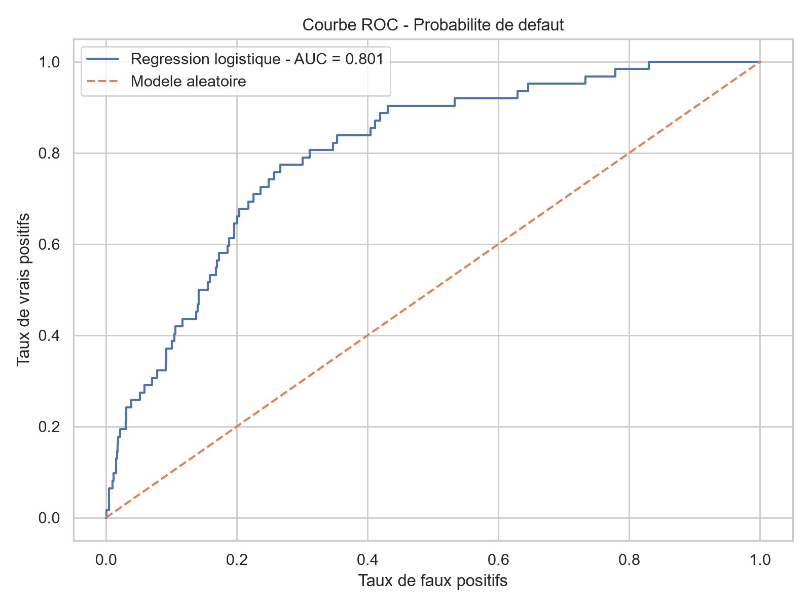
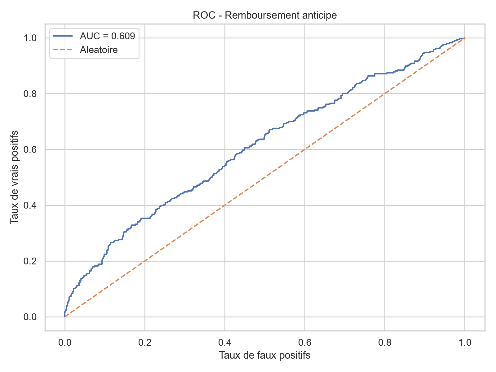
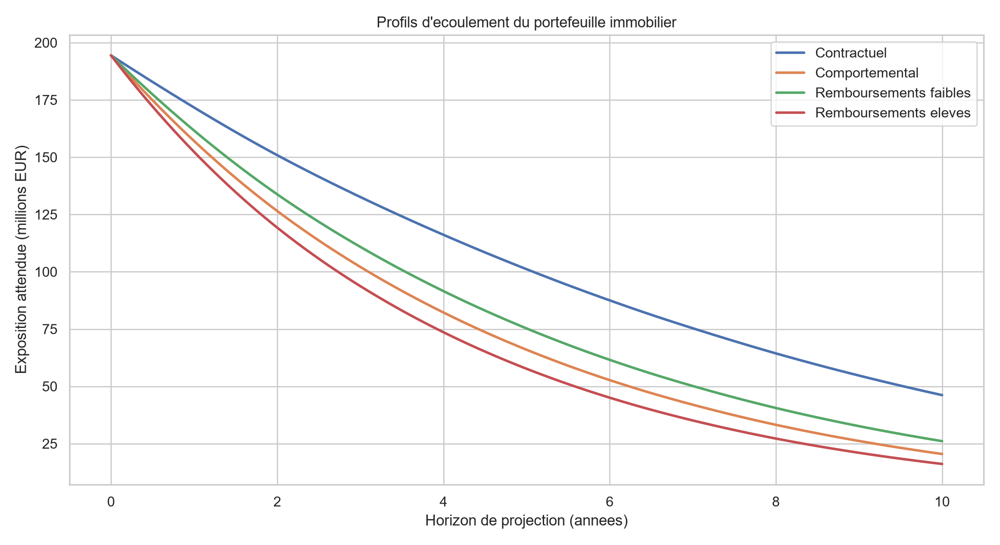
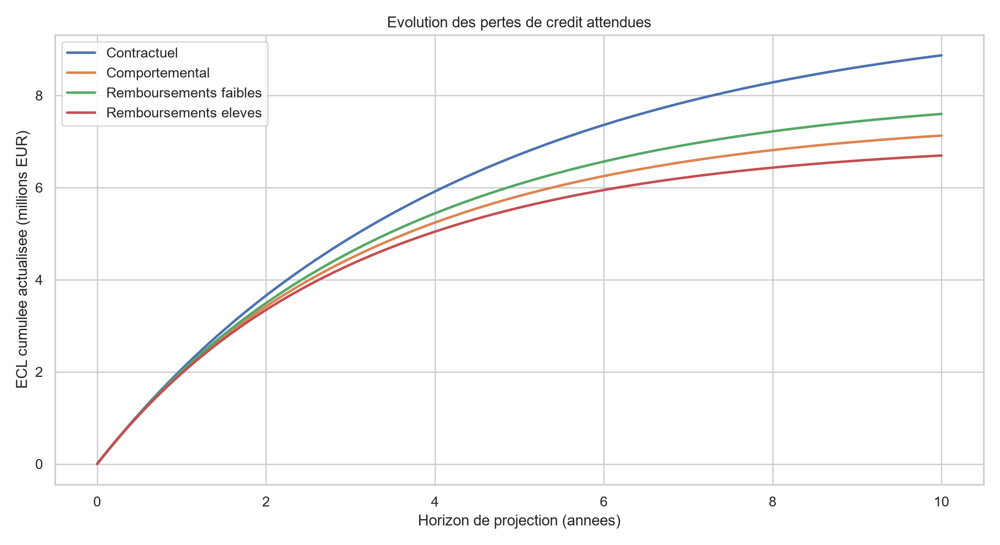

# Credit Risk and IFRS 9 Modeling

## Project Overview

This project explores mortgage credit risk modeling,
early repayment behavior and Expected Credit Loss (ECL)
estimation using a simplified IFRS 9 framework.

The objective is to assess the impact of partial and full
early repayments on mortgage portfolio runoff profiles
and expected credit losses.

## Dataset

A synthetic portfolio of 10,000 mortgage loans was
generated using Python and NumPy.

| Indicator | Value |
|---|---:|
| Number of loans | 10,000 |
| Initial loan amount | EUR 1.69 billion |
| Outstanding exposure | EUR 990.97 million |
| Default rate | 3.09% |
| Early repayment rate | 14.08% |
| Guaranteed loans | 70.02% |

## Methodology

1. Synthetic mortgage portfolio generation.
2. Exploratory data analysis and data quality checks.
3. Probability of Default (PD) modeling.
4. Early repayment probability modeling.
5. Partial and full repayment analysis.
6. Monthly exposure projection over 10 years.
7. Discounted expected credit loss estimation.
8. Sensitivity analysis across four scenarios.

## Machine Learning Results

| Model | ROC AUC |
|---|---:|
| Probability of Default | 0.8006 |
| Early repayment | 0.6085 |
| Full repayment | 0.4939 |

Logistic regression was used with standardized features
and a stratified 80/20 train-test split.

The full repayment model did not outperform the
historical-rate baseline. Therefore, a historical
conditional full repayment rate of 34.22% was retained.

The average partial repayment represents 24.85%
of the outstanding loan balance.

### Probability of Default

### Early Repayment

## Exposure Runoff Profiles

The financial projections were performed on a held-out
test portfolio of 2,000 mortgage loans representing
EUR 194.44 million in initial outstanding exposure.

## Expected Credit Loss Results

| Scenario | 12-month ECL | 10-year ECL | Reduction |
|---|---:|---:|---:|
| No early repayment | EUR 2.057M | EUR 8.871M | 0.00% |
| Low repayment | EUR 2.010M | EUR 7.599M | 14.34% |
| Behavioral | EUR 1.988M | EUR 7.129M | 19.64% |
| High repayment | EUR 1.966M | EUR 6.696M | 24.52% |

## Key Findings

- Credit score, debt-to-income ratio and loan-to-value
  ratio are important default risk predictors.

- Interest rate and debt-to-income ratio are associated
  with early repayment behavior.

- Incorporating modeled early repayments reduces
  projected 10-year ECL by 19.64% in the behavioral
  scenario compared with the no-prepayment baseline.

- Sensitivity analysis highlights the importance of
  behavioral assumptions in long-term credit risk models.

## Technologies

- Python
- Pandas
- NumPy
- Scikit-learn
- Matplotlib
- Seaborn
- Joblib
- Git and GitHub

## Project Structure

    credit-risk-ifrs9-modeling/
    |
    |-- data/
    |-- src/
    |   |-- generate_data.py
    |   |-- exploratory_analysis.py
    |   |-- pd_model.py
    |   |-- prepayment_model.py
    |   |-- ifrs9_projection.py
    |-- models/
    |-- outputs/
    |-- reports/
    |-- requirements.txt
    |-- README.md

## Reproducibility

Install the required dependencies:

    pip install -r requirements.txt

Run the scripts in the following order:

    python src/generate_data.py
    python src/exploratory_analysis.py
    python src/pd_model.py
    python src/prepayment_model.py
    python src/ifrs9_projection.py

## Limitations

This project is an educational prototype based entirely
on synthetic data. It is not a regulatory IFRS 9 model.

Key limitations include:

- No real banking data or external validation.
- No observed longitudinal default or repayment history.
- Constant projected default and repayment probabilities.
- Assumed LGD values.
- Simplified amortization after partial repayments.
- No macroeconomic scenario weighting.
- No IFRS 9 staging or significant increase in credit risk.
- A 10-year horizon rather than full lifetime ECL.
- Zero default recall at the 0.5 classification threshold.
- Full repayment model selection used the test dataset
  rather than a separate validation dataset.

The simulated annual probabilities and financial results
should not be interpreted as validated banking estimates.

## Author

Junior NGOMSU

MSc Data Management - ECE Paris

Academic background in Mathematics, Finance and Accounting.

Interests: Data Science, Credit Risk, Financial Modeling
and Banking Analytics.

## Project Report

[Download the full project report (French - PDF)](reports/Rapport_IFRS9_Junior_NGOMSU.pdf)

